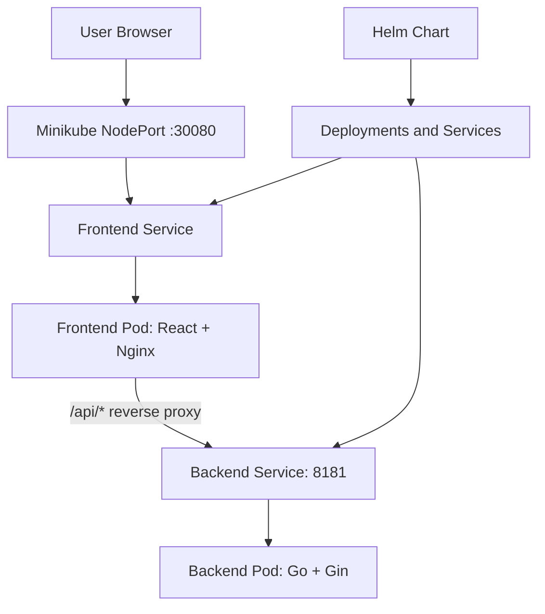

# Cloud-Native Portfolio Deployment on Kubernetes with Helm

A full-stack portfolio application built with **React, Go (Gin), Docker, Kubernetes, Minikube, and Helm**. The application is containerized and deployed to a local Kubernetes cluster, with Nginx serving the frontend and reverse-proxying API requests to the backend.

## Table of Contents

- [Overview](#overview)
- [Architecture](#architecture)
- [Technology Stack](#technology-stack)
- [Project Structure](#project-structure)
- [Request Flow](#request-flow)
- [Prerequisites](#prerequisites)
- [Getting Started](#getting-started)
- [Build and Load Docker Images](#build-and-load-docker-images)
- [Deploy with Helm](#deploy-with-helm)
- [Verify the Deployment](#verify-the-deployment)
- [Useful Commands](#useful-commands)
- [Troubleshooting](#troubleshooting)
- [What I Learned](#what-i-learned)

## Overview

This project demonstrates a practical containerization and Kubernetes deployment workflow for a portfolio website.

Key features:

- React frontend served by Nginx.
- Go backend built with the Gin web framework.
- Docker images for the frontend and backend.
- Kubernetes Deployments and Services for application workloads.
- Helm chart to template and manage Kubernetes resources.
- Minikube for running Kubernetes locally.
- Nginx reverse proxy for routing `/api/` requests to the backend.
- NodePort access to the frontend from the local machine.

## Architecture



### Kubernetes Resources

| Resource | Name | Purpose |
|---|---|---|
| Deployment | `my-portfolio-frontend` | Runs the frontend container |
| Service | `my-portfolio-frontend` | Exposes frontend using NodePort `30080` |
| Deployment | `my-portfolio-backend` | Runs the Go API container |
| Service | `my-portfolio-backend` | Exposes the backend inside the cluster on port `8181` |

## Technology Stack

| Technology | Purpose |
|---|---|
| React | Frontend user interface |
| Nginx | Static file server and API reverse proxy |
| Go | Backend programming language |
| Gin | HTTP framework for the backend API |
| Docker | Application containerization |
| Kubernetes | Container orchestration |
| Minikube | Local Kubernetes cluster |
| Helm 3 | Kubernetes package and release management |
| Git and GitHub | Source control and project hosting |

## Project Structure

```text
my_portfolio/
├── frontend/
│   ├── src/
│   ├── nginx.conf
│   ├── Dockerfile
│   └── package.json
├── backend/
│   ├── main.go
│   ├── Dockerfile
│   └── go.mod
├── portfolio/
│   ├── Chart.yaml
│   ├── values.yaml
│   └── templates/
│       ├── frontend-deployment.yaml
│       ├── frontend-service.yaml
│       ├── backend-deployment.yaml
│       └── backend-service.yaml
├── compose.yaml
└── Jenkinsfile
```

## Request Flow

1. A user opens the frontend through the Minikube NodePort.
2. The frontend Service routes traffic to the frontend Pod.
3. Nginx serves the React application.
4. Requests under `/api/` are proxied to `http://my-portfolio-backend:8181`.
5. The backend Service forwards the request to the Go/Gin backend Pod.
6. The API response returns through Nginx to the browser.

## Prerequisites

Install these tools:

- Docker
- Minikube
- `kubectl`
- Helm 3
- Git

Check the installations:

```bash
docker --version
minikube version
kubectl version --client
helm version
git --version
```

Start Minikube:

```bash
minikube start
minikube status
kubectl get nodes
```

## Getting Started

Clone the repository:

```bash
git clone https://github.com/VarunPandya07/my_portfolio.git
cd my_portfolio
```

## Build and Load Docker Images

Frontend image:

`mrpandya3117/varun-portfolio-frontend:latest`

Backend image:

`mrpandya3117/varun-portfolio-backend:latest`

Build both images from the repository root:

```bash
docker build -t mrpandya3117/varun-portfolio-frontend:latest ./frontend

docker build -t mrpandya3117/varun-portfolio-backend:latest ./backend
```

Load them into Minikube:

```bash
minikube image load mrpandya3117/varun-portfolio-frontend:latest

minikube image load mrpandya3117/varun-portfolio-backend:latest
```

To publish the images to Docker Hub:

```bash
docker login

docker push mrpandya3117/varun-portfolio-frontend:latest

docker push mrpandya3117/varun-portfolio-backend:latest
```

### Nginx Reverse Proxy

The frontend Nginx configuration routes API requests to the Kubernetes backend Service:

```nginx
location /api/ {
    proxy_pass http://my-portfolio-backend:8181;
    proxy_set_header Host $host;
    proxy_set_header X-Real-IP $remote_addr;
}
```

If you modify this configuration, rebuild and reload the frontend image before upgrading the Helm release.

## Deploy with Helm

Enter the Helm chart directory:

```bash
cd portfolio
```

Validate the chart:

```bash
helm lint .
helm template my-portfolio .
```

Install or upgrade the application:

```bash
helm upgrade --install my-portfolio .
```

- `helm lint .` checks the chart for common issues.
- `helm template my-portfolio .` renders Kubernetes manifests locally.
- `helm upgrade --install my-portfolio .` installs or updates the release.

## Verify the Deployment

Check Pods, Deployments, and Services:

```bash
kubectl get pods
kubectl get deployments
kubectl get services
```

Check rollout status:

```bash
kubectl rollout status deployment/my-portfolio-frontend
kubectl rollout status deployment/my-portfolio-backend
```

Get the frontend URL:

```bash
minikube service my-portfolio-frontend --url
```

Open the resulting URL in your browser.

### Test the Backend API

Run a temporary curl Pod to test the API from inside Kubernetes:

```bash
kubectl run api-test --rm -it --restart=Never \
  --image=curlimages/curl -- \
  curl -i http://my-portfolio-backend:8181/api/v1/projects
```

Check backend logs if needed:

```bash
kubectl logs deployment/my-portfolio-backend
```

Verify that project data appears on the frontend and check the browser console for failed API requests.

## Useful Commands

```bash
# View resources
kubectl get all

# View Pods with IP details
kubectl get pods -o wide

# Follow frontend logs
kubectl logs deployment/my-portfolio-frontend -f

# Follow backend logs
kubectl logs deployment/my-portfolio-backend -f

# Inspect a Pod
kubectl describe pod <pod-name>

# List Helm releases
helm list

# Inspect the Helm release
helm status my-portfolio

# Upgrade the application
helm upgrade my-portfolio .

# Uninstall the release
helm uninstall my-portfolio
```

## Troubleshooting

### Pods are not running

```bash
kubectl get pods
kubectl describe pod <pod-name>
kubectl get events --sort-by=.metadata.creationTimestamp
```

Check events for image pull failures, scheduling errors, or container crashes.

### Inspect application logs

```bash
kubectl logs deployment/my-portfolio-frontend
kubectl logs deployment/my-portfolio-backend
```

### Frontend loads but project data does not appear

1. Confirm the backend Pod is ready.
2. Verify the backend Service exposes port `8181`.
3. Check that Nginx proxies requests to `my-portfolio-backend:8181`.
4. Rebuild and reload the frontend image after Nginx changes.
5. Review application logs and the browser developer console.

### Helm chart validation fails

```bash
helm lint .
helm template my-portfolio . --debug
```

Check YAML indentation, values names, and template references.

## What I Learned

- Containerizing a React frontend and Go backend with Docker.
- Serving frontend files through Nginx.
- Configuring reverse proxy routing for API requests.
- Deploying workloads using Kubernetes Deployments and Services.
- Exposing the frontend through NodePort while keeping the backend internal with ClusterIP.
- Managing Kubernetes resources using Helm charts.
- Validating and upgrading Helm releases.
- Troubleshooting deployments using logs, events, and resource descriptions.

## Future Improvements

- Add a Jenkins CI/CD pipeline to build, test, and publish images automatically.
- Add automated tests and container image vulnerability scanning.
- Configure resource requests, limits, readiness probes, and liveness probes.
- Add monitoring with Prometheus and Grafana.
- Deploy to a managed Kubernetes cluster and configure HTTPS with a domain.

---

**Author:** [Varun Pandya](https://github.com/VarunPandya07)

**Repository:** [my_portfolio](https://github.com/VarunPandya07/my_portfolio)
